# Oxplorer

A fast file explorer for Windows, written in Rust.

Oxplorer looks and works like Windows Explorer, but adds tab groups, a
quick-access start page, much faster search and its own copy engine. When you
copy or move files you don't get the slow Windows copy dialog. A multi-threaded
Rust engine does the work and shows progress in a panel inside the window.

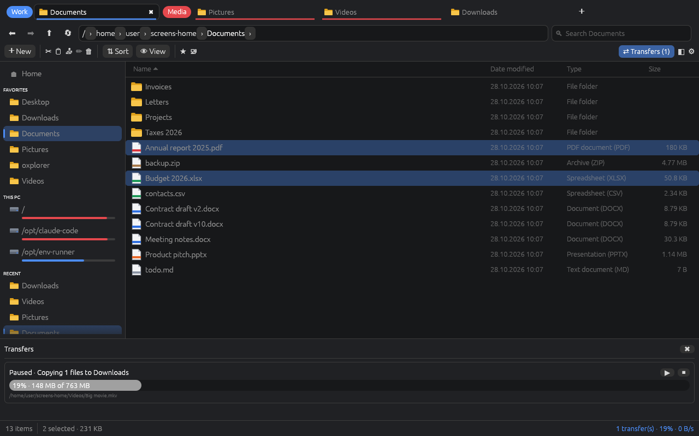

## Download

**[Oxplorer 1.0](https://github.com/Flory-1/oxplorer/releases/latest)** for Windows 10 (1809)
and 11, 64-bit:

- **Installer** (`oxplorer-v1.0.0-setup-x64.exe`): installs for your user, no admin rights needed
- **Portable** (`oxplorer-v1.0.0-windows-x64.zip`): unzip and run `oxplorer.exe`

What's new: [CHANGELOG.md](CHANGELOG.md). What's next: [ROADMAP.md](ROADMAP.md).

> The app is developed and tested by hand on Linux; the automated tests, including the
> `CopyFileExW` copy path, pass on Windows in CI. Some Windows-only features (Shell icons,
> thumbnails and context menu, drag out, network locations, the window backdrop, opening
> folders by default) build and are tested for Windows but haven't been tried by hand yet.
> Please [report anything that doesn't work](https://github.com/Flory-1/oxplorer/issues).

## Features

**Explorer basics**
- Details and grid views, sortable columns, natural sort order (`file2` before `file10`)
- Multi-select with Ctrl/Shift, Ctrl+A, arrow keys, Home/End, and type-to-jump
- Back/forward/up (mouse side buttons work too) and a breadcrumb address bar.
  Click a `›` to jump into a sub-folder. Click the empty part of the bar to type
  a path; `%USERPROFILE%` and `~` are expanded.
- New folder or file, rename (F2), delete to the Recycle Bin, permanent delete (Shift+Del), properties with folder size.
  Add your own file types to ➕ New (e.g. *Python script*, *Markdown document*) with a file name
  and content to start with (Settings → New menu).
- The view refreshes by itself when files change on disk
- Open in Terminal, Show in Windows Explorer, Copy path
- **Recycle Bin view**: browse deleted items with their original location, restore them,
  delete them permanently or empty the bin. Drop files onto it in the sidebar to delete them.

**Windows integration**
- The same file icons as Explorer (loaded in the background, cached per file type)
- **Show more options** (or Shift+F10) opens the real Explorer context menu, so
  entries from 7-Zip, VS Code, Git and other tools are there
- Native Properties dialog and "Open with…"
- **Thumbnails** of pictures, videos and PDFs in the grid view (the same ones Explorer shows)
- **Drag files out** of Oxplorer into other programs (Explorer, mail, editors…)
- **Network locations**: type `\\server` to see its shares, browse `\\server\share` like any
  folder, mapped network drives under *This PC*, the servers you use under *Network*, and
  *Map network drive…* from a drive's right-click menu or the command palette
- **Mica or Acrylic** window backdrop on Windows 11 (Settings → Appearance), rounded corners
  and a title bar that follows dark/light mode
- **Open folders in Oxplorer** instead of Explorer (Settings → Startup): folders and drives
  opened on the desktop or from other programs, and Win+E, open in Oxplorer. Turn it off to
  go back to Explorer.
- App icon, per-monitor DPI awareness and long-path support through the app manifest

**Tabs and tab groups**
- Tabs in the header bar. Drag them to reorder, middle-click to close.
- Chrome-style **tab groups** with names and colours. Click a group chip to collapse or expand it.
- Drag files onto a tab to switch to it, then drop them inside
- Optionally restores your tabs and groups on startup

**Quick access**
- **Home start page** with pinned favorites, drives with usage bars, recent folders and recent files
- **Sidebar** with Home, Favorites, This PC (drives), Recent, Tags and Saved searches.
  Recycle Bin, Settings and Help are pinned at the bottom.
- Pin or unpin any folder from its context menu; drop files onto a favorite to copy or move them there

**Custom copy engine** (`ox-core::transfer`)
- Never opens the Windows shell copy dialog
- Several files are copied in parallel. On Windows each file goes through
  `CopyFileExW` (the kernel fast path), and very large files use unbuffered I/O.
- Moves on the same drive are a single rename and finish instantly. Across drives it copies, then deletes.
- Asks **once per job** when files already exist (Replace / Skip / Keep both / Replace if newer), not once per file
- Pause, resume, cancel, live speed and time left, and a per-file error list
- **Per-disk queue**: copies on the same drive wait for each other, copies between different drives run in parallel
- **Auto worker count**: one file at a time on HDDs (no seek storms), 8 in parallel on SSDs
- Optional **verification** (xxh3 hash of original and copy). Moves only delete originals that were copied correctly.
- **Retry failed files** with one click, an optional **speed limit**, and a **transfer history** log
- Shares the clipboard with Windows Explorer in both directions (CF_HDROP + Preferred DropEffect).
  Copy in Explorer and paste in Oxplorer, and the paste still runs through the fast engine.

**Search** (`ox-core::search`, `ox-core::index`)
- Typing in the search box filters the current folder instantly
- A **file-name index** of your drives makes searching everything instant: start
  typing on the Home page and results appear as you type (280k files are
  searched in milliseconds). The index is saved between runs and refreshed in the
  background.
- **Enter** searches all sub-folders: from the index when it covers the folder,
  otherwise with a multi-threaded walker (the same parallel walker as ripgrep)
- **Filter chips** for kind, date and size, and **saved searches** in the sidebar
- Query syntax:

  | Query | Meaning |
  |---|---|
  | `report` / `"annual report"` | name contains the word / phrase |
  | `*.rs`, `img_??` | wildcards |
  | `/^IMG_\d+\.jpe?g$/` | regular expression (also `regex:…`) |
  | `-tmp` | exclude |
  | `ext:pdf,docx` | by extension |
  | `type:folder`, `type:file` | only folders / files |
  | `kind:image,video` | by kind (image, video, audio, document, archive, code, app) |
  | `size:>10mb`, `size:<1kb` | by size |
  | `modified:7d`, `modified:today` | recently changed |
  | `content:"TODO"` | text inside files |

**Power tools**
- **Preview pane** (Alt+P) with tabs: **Info** (size, location, dates, attributes and what the
  file type adds) plus a tab for the content: images, code with syntax highlighting, the first
  page of PDFs (on Windows), cover art, and for fonts a sample at several sizes and a **Glyphs**
  grid of every character (click one to copy it). Loads in the background, so large files never
  block the window.
  - **Player**: audio and video play right in the preview (on Windows, with Windows' own media
    engine, so every format Windows plays works): seek bar, 10 s back/forward, repeat, volume.
  - **Markdown**: `.md` files formatted, with tables, task lists, highlighted code blocks and
    the pictures next to them.
  - **Git**: for folders in a repository, the history of all branches as a commit graph with
    branches, tags, authors and dates. Click a commit to copy its hash.
- **Bulk rename** (F2 with several items selected): build names from a pattern
  (`{name}`, `{ext}`, `{n:3}`, `{date}`, `{parent}`), find & replace with text or regex,
  change case, and see every new name before anything changes. Name clashes are
  caught in the preview, and if one rename fails the others are rolled back.
- **Command palette** (Ctrl+Shift+P): type a few letters to run any command or
  jump to a favorite, drive, recent folder or saved search
- **Split view** (Ctrl+\\ or the ◫ button): two folders side by side. Click a pane or press
  F6 to work in it, and drag files from one pane to the other.
- **Archives as folders**: double-click a `.zip`, `.7z`, `.tar`, `.tar.gz` or `.tgz` file to browse it,
  preview files inside it, and drag or copy items out to extract them. Right-click an archive for
  *Extract here* / *Extract to "name"*, or any selection for *Compress to ZIP*.
- **Git status**: inside a Git repository a *Git* column shows what changed (M, A, D, R, ?, I).
  Folders show the most important change inside them, and the status bar shows the branch
  (`Git: main ↑2 · 3 changes`). Needs Git installed.
- **Terminal panel** (Ctrl+`): a real terminal under the file view running PowerShell (or any
  shell you set), with colours, scrollback and full-screen programs. It opens in the current
  folder (also when shown again later), or let it follow every folder you open (Settings → Browsing).
- **Folder sizes** in the Size column, calculated in the background and cached. Sort by
  size to find what fills your disk.
- **Colour tags**: right-click → Tags to mark files and folders. Tagged items get coloured
  dots and show up under *Tags* in the sidebar. Rename a tag (e.g. Red → Urgent) from its
  right-click menu. Tags follow items you rename or move in Oxplorer.

**For developers**
- **Open in editor** (Ctrl+Shift+E, right-click, command palette): VS Code by default, or any
  editor command in Settings → Developer (presets for Cursor, Zed, Sublime Text, Notepad++ …)
- **Copy path as**: with forward slashes, in quotes, relative to the Git repository, as a
  `file://` URL, or just the name
- **Git** in the right-click menu: open the file or folder on GitHub, GitLab or Bitbucket,
  copy the branch name. The Info tab shows the last commit that changed the selected item.
- Text files show their **encoding**, **line endings** (CRLF/LF) and **indentation** (tabs,
  2 or 4 spaces); **checksums** (SHA-256, MD5) of any file on request

**Help page** (F1 or *Help* at the bottom of the sidebar): getting started, every feature,
the search syntax, your current keyboard shortcuts and common questions, with a filter to
find a topic.

**Languages**: English and German (Deutsch). By default Oxplorer follows the Windows display
language; Settings → Appearance → Language picks one. Everything is translated, including the
Help page, messages and key names (*Strg+C*, *Entf*), and numbers use a decimal comma in German.

**Settings page**
- Appearance: language, system/light/dark mode, a **colour theme** for each mode (Dark, Light, Nord, Dracula,
  Solarized Light, High contrast or your own), accent colour, compact rows,
  thumbnails, window backdrop.
  Change any theme's colours; **export** a theme as a small `.toml` file to share it, and
  right-click a theme file → *Use as theme* to install one.
- Browsing, startup, sidebar (incl. its width), preview pane (as a pane or its own window, and its
  width), the New menu's own entries, developer options (editor), copy engine and search
  options, plus a list of keyboard shortcuts
- The window opens where you left it, with the same size (and maximized if it was)
- Saved as TOML in `%APPDATA%\Oxplorer\`

| Home / Quick access | Grid view with thumbnails (light) |
|---|---|
| 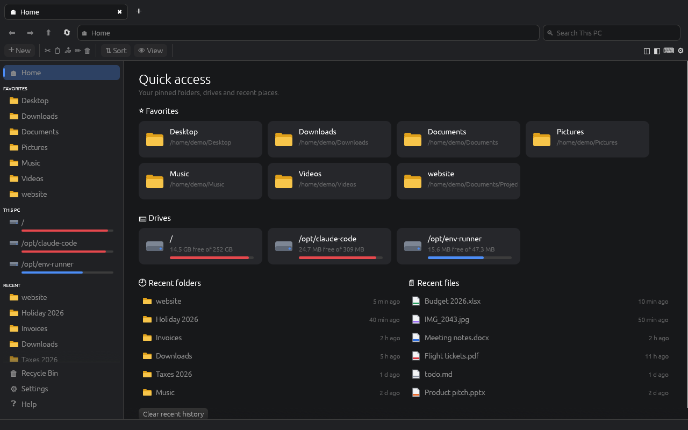 | 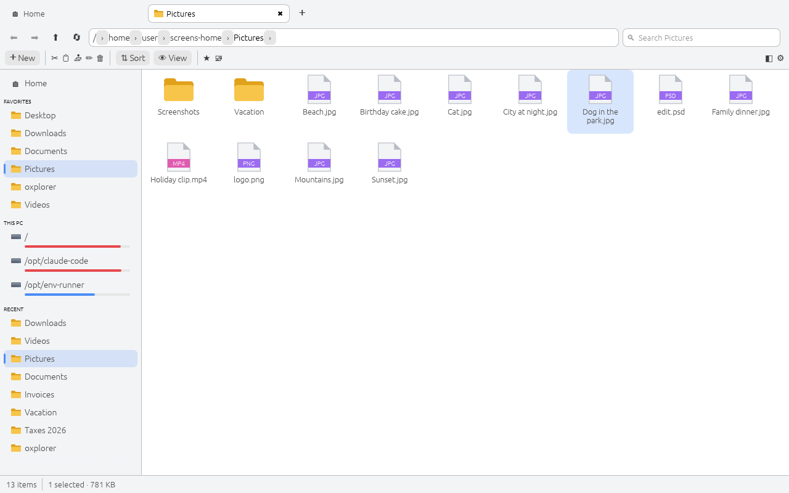 |
| **Search: deep search from the index, filter chips** | **Preview pane** |
| 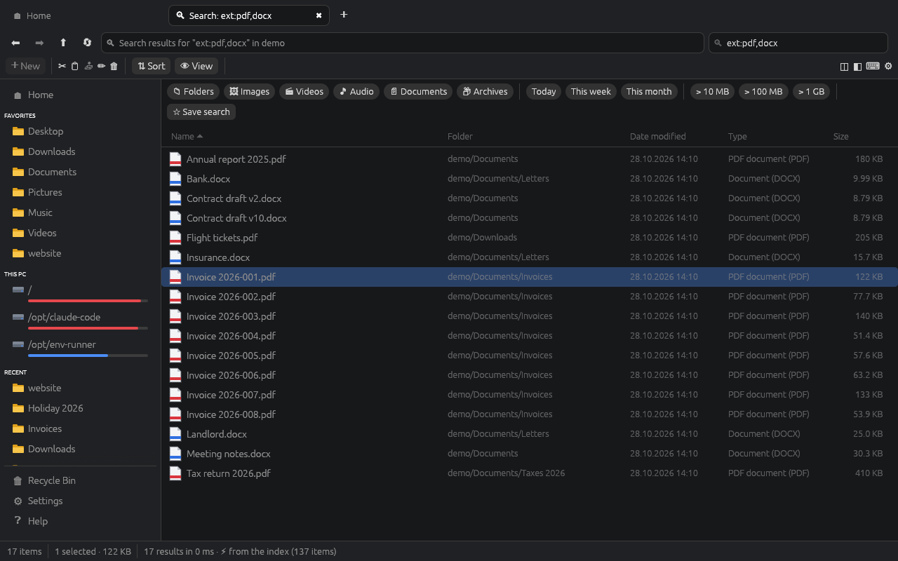 | 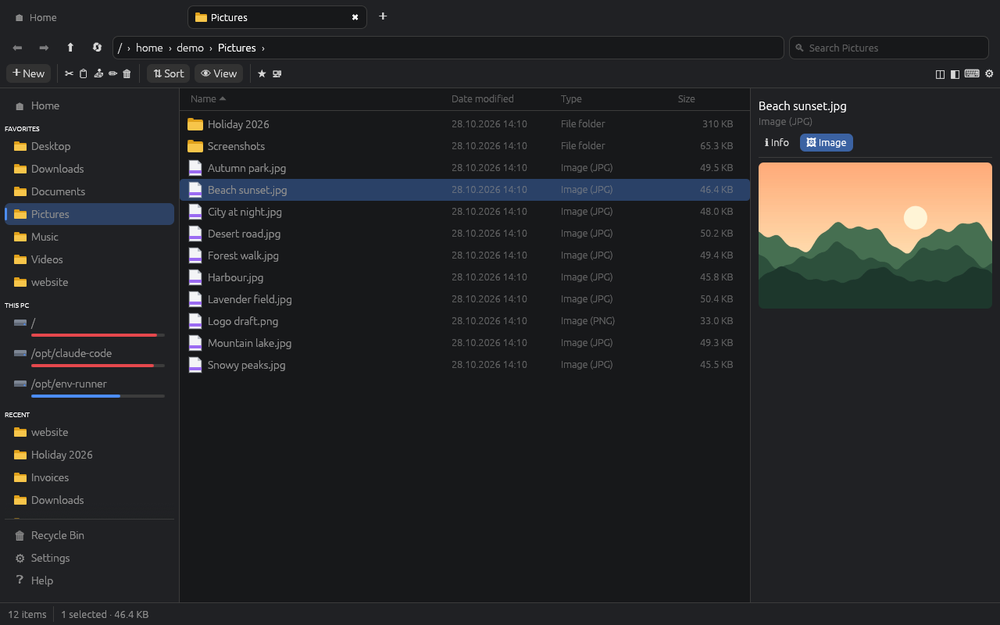 |
| **Git status, colour tags and folder sizes** | **Split view** |
| 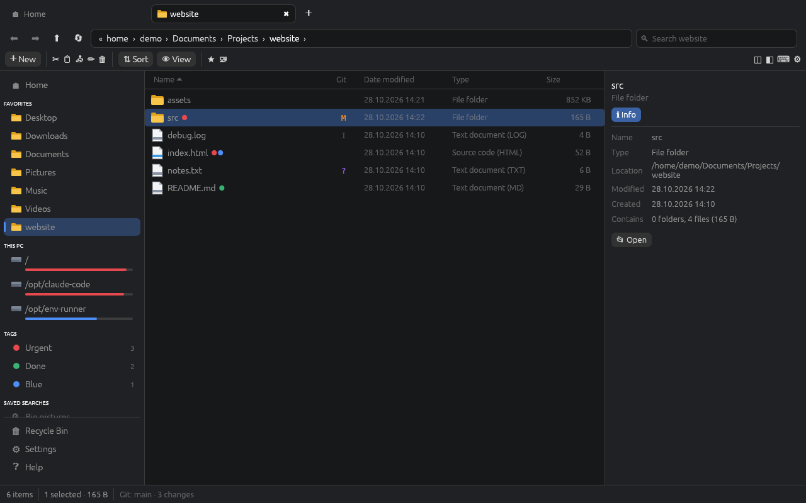 | 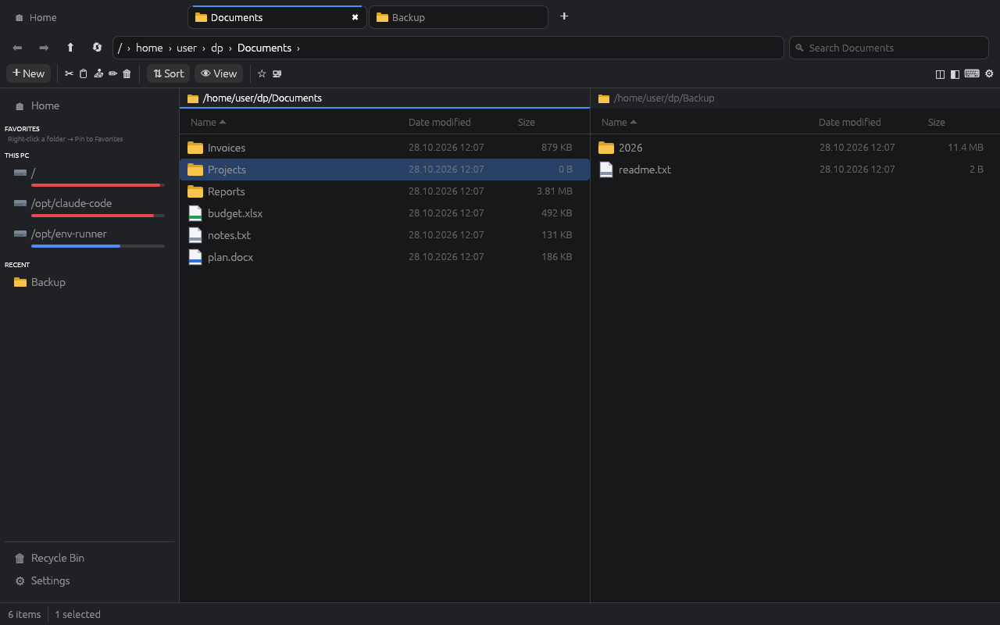 |
| **Git graph in the preview** | **Markdown preview (light)** |
| 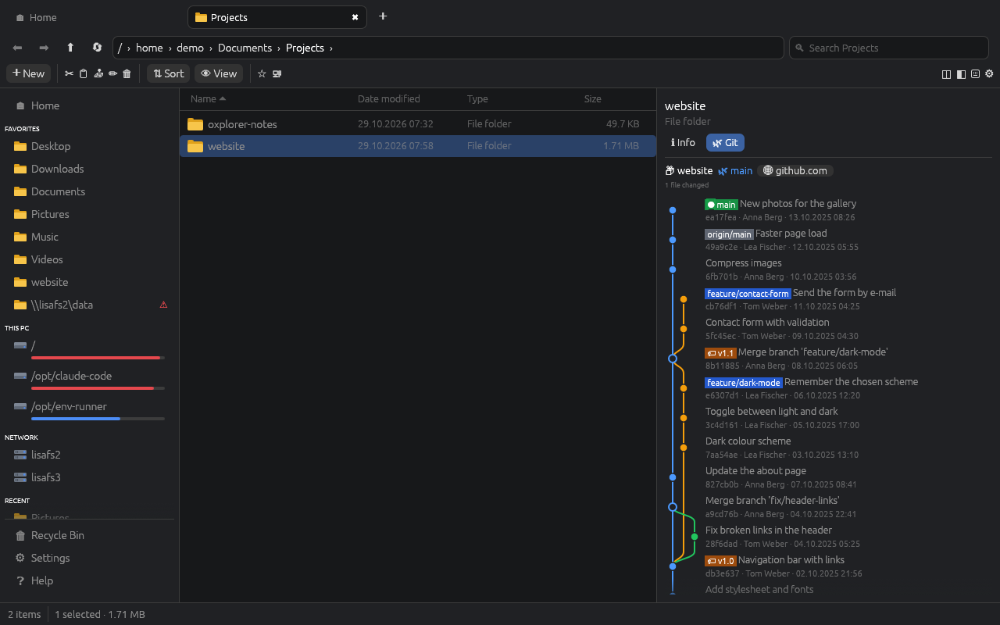 | 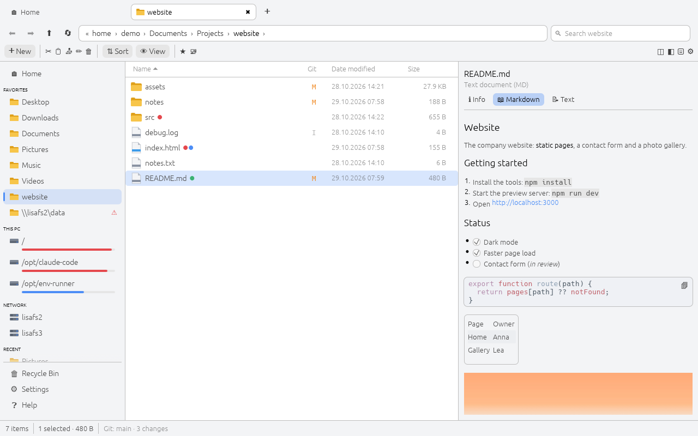 |
| **Font preview with the Glyphs grid** | **Nord theme and code preview** |
| 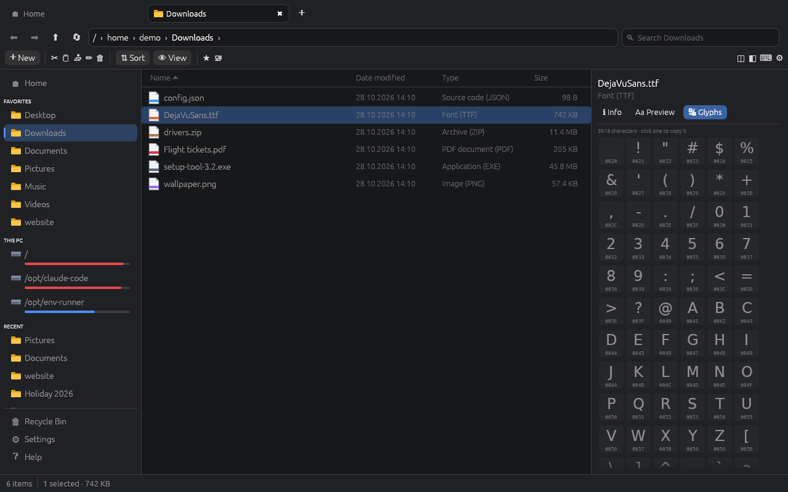 | 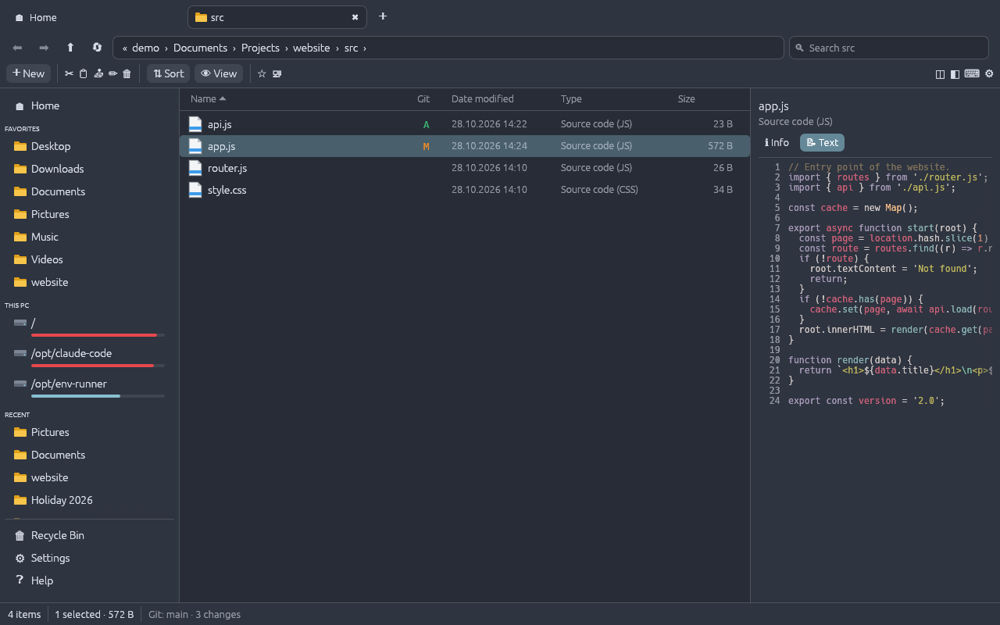 |
| **Recycle Bin** | **Settings (light)** |
| 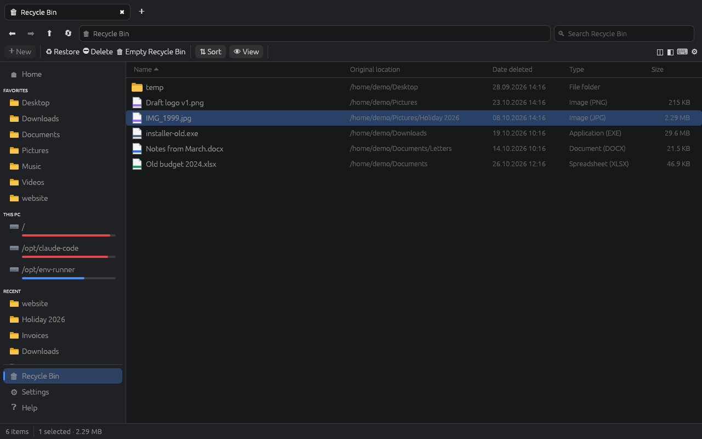 | 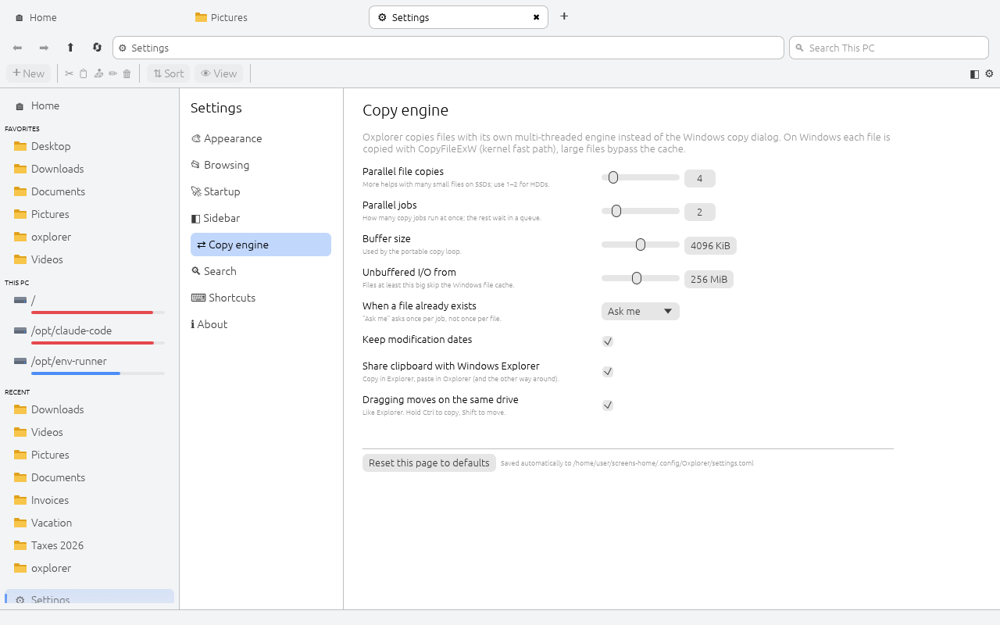 |
| **Help page (F1)** | **German interface** |
| 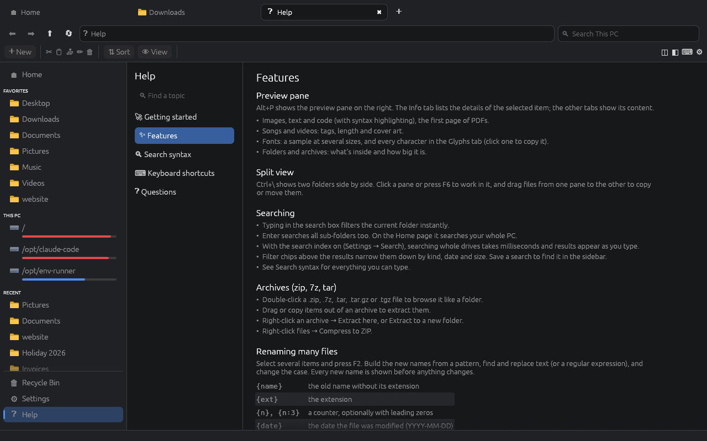 | 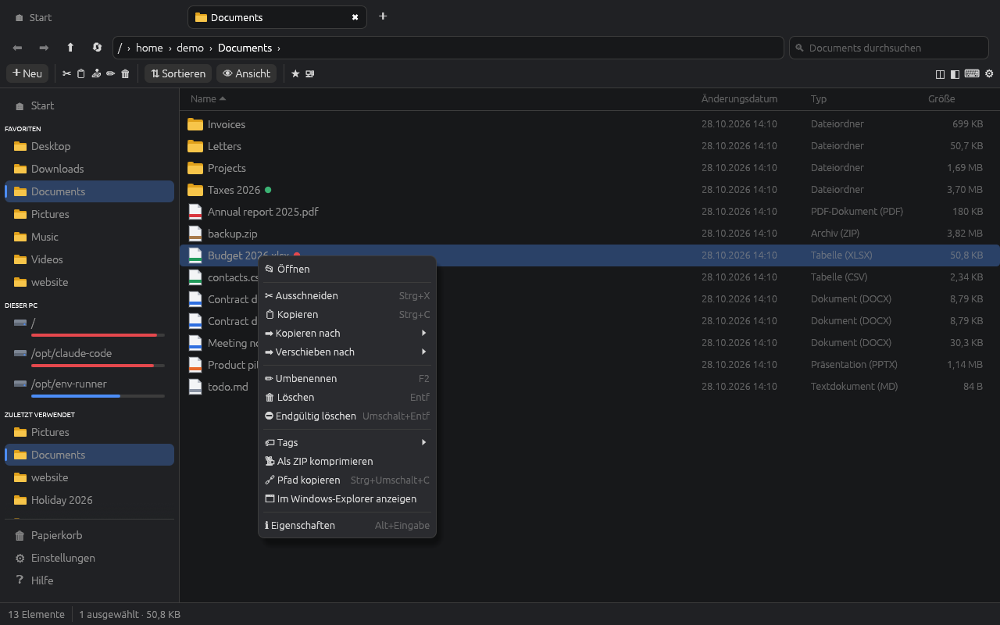 |

*The screenshots were taken on Linux, which is why the drives show as mount points and the
built-in icons are used. On Windows the drives show as `Local Disk (C:)` and so on, with
the real Windows file icons and thumbnails.*

## Building

You need the latest stable [Rust](https://rustup.rs/) toolchain.

```bash
cargo run --release
```

The binary is `target/release/oxplorer.exe`. To open a folder directly, pass its path:

```bash
oxplorer.exe "C:\Users\me\Documents"
```

CI builds a Windows binary and installer on every push to `main`. Download them from the
**Actions** tab, under the artifact `oxplorer-windows-x64`. Pushing a version
tag (e.g. `v1.0.0`) publishes on the **Releases** page:

- `oxplorer-<version>-setup-x64.exe`: installer (per user, no admin rights needed), with
  Start menu entry and the option to open folders in Oxplorer. Uninstalling gives folders
  back to Explorer.
- `oxplorer-<version>-windows-x64.zip`: portable version, just unzip and run
- `oxplorer-<version>-winget.zip`: winget manifests for the release, ready to submit to
  [microsoft/winget-pkgs](https://github.com/microsoft/winget-pkgs) (then
  `winget install Flory-1.Oxplorer`)

The installer is built with [Inno Setup](https://jrsoftware.org/isinfo.php) from
`installer/oxplorer.iss` (`installer/build.ps1` builds it and the manifests).

To make a release:

1. Set the new version in `Cargo.toml`, `crates/ox-app/assets/oxplorer.rc` and
   `crates/ox-app/assets/oxplorer.manifest` (a test fails if they differ).
2. Add a `## [x.y.z] - date` section to `CHANGELOG.md`; it becomes the release notes.
3. Merge to `main`, then tag that commit `vx.y.z` and push the tag. The release workflow
   refuses a tag that doesn't match the version.

Run the tests:

```bash
cargo test --workspace
```

### Translations

The English text is the key: wrap texts people see in `tr("…")` (`ox_core::i18n::t`), or
`ox_core::trf!("{n} selected", n = count)` for texts with values, and add the German version to
`crates/ox-core/src/i18n_de.rs`. A test lists every wrapped text that has no German version yet,
so a missing translation fails CI.

## Project layout

```
crates/
  ox-core/            UI-independent logic (unit tested)
    transfer/         copy/move engine: scan → conflict decision → parallel copy
    search.rs         query language, parallel walker, indexed search
    index.rs          persistent file-name index (build, query, cache)
    rename.rs         bulk rename: patterns, preview, safe apply with rollback
    fuzzy.rs          fuzzy matching for the command palette
    dirsize.rs        background folder sizes with a shared cache
    archive.rs        zip/7z/tar browsing, extraction and zip compression
    git.rs            Git status via the git command line
    pdf.rs            PDF first-page previews (Windows.Data.Pdf)
    tags.rs           colour tags (stored in tags.toml)
    themes.rs         colour themes (built-in + .toml files)
    disk.rs           volume ids, HDD/SSD detection
    entry.rs          directory listing, file kinds, sorting
    clipboard.rs      file clipboard, shared with Windows Explorer
    shell.rs          Windows Shell: icons, thumbnails, native context menu, Properties,
                      Open with, drag out, window backdrop
    network.rs        \\server shares, mapped network drives
    default_app.rs    "open folders in Oxplorer" (registry, HKCU)
    recycle.rs        Recycle Bin: list, restore, purge
    places.rs         favorites, recent items, known folders, drives
    settings.rs       settings (TOML)
    i18n.rs           translations (English text as key), i18n_de.rs: German
    fsops.rs          create / rename / delete / shell helpers
    watcher.rs        auto-refresh when a folder changes
  ox-app/             the egui/eframe desktop app ("oxplorer" binary)
    app.rs            state + action dispatcher + keyboard shortcuts
    tabs.rs           tabs, tab groups, history, session restore
    shortcuts.rs      keyboard shortcuts: commands, defaults, the user's keys
    terminal.rs       terminal panel (alacritty_terminal + egui)
    thumbs.rs         thumbnail cache for the grid view
    ui/               header (tabs, address, search, commands), sidebar,
                      home page, file view, preview pane, command palette,
                      settings page, transfers, dialogs
```

installer/            Inno Setup script, winget manifest templates, build script

The UI is [egui](https://github.com/emilk/egui) (immediate mode, GPU
rendered). That keeps the app a single small native `.exe` with no web runtime.

## Keyboard shortcuts

All of these can be changed in **Settings → Shortcuts**: click a shortcut and press the new keys.
Menus, tooltips and the command palette always show the keys in use.

| Keys | Action |
|---|---|
| Ctrl+T / Ctrl+W | New tab / close tab |
| Ctrl+Tab / Ctrl+Shift+Tab | Next / previous tab |
| Alt+← / Alt+→ / Alt+↑ / Backspace | Back / forward / up |
| Ctrl+L | Edit address |
| Ctrl+F | Search |
| Ctrl+C / Ctrl+X / Ctrl+V | Copy / cut / paste (works with Explorer too) |
| Ctrl+Shift+C | Copy path |
| F2 / Del / Shift+Del | Rename (bulk rename for several items) / delete / delete permanently |
| Ctrl+Shift+N | New folder |
| Alt+Enter | Properties |
| Shift+F10 | Windows context menu ("Show more options") |
| F5 | Refresh |
| Ctrl+, | Settings |
| Ctrl+Shift+P | Command palette |
| F1 | Help |
| Alt+P | Preview pane |
| Ctrl+\\ / F6 | Split view / switch pane |
| Ctrl+` | Terminal panel |
| Ctrl+Shift+E | Open in editor |

## Roadmap

See [ROADMAP.md](ROADMAP.md). Phase 5 is done. Next up: Phase 6
(localisation and accessibility) and the 1.0 release.

## License

MIT
